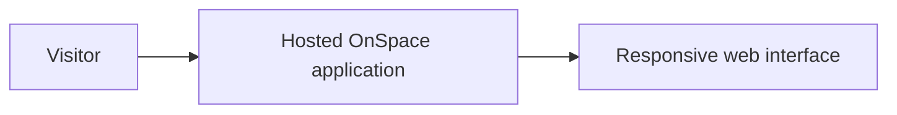

# AI-Powered React Web Application

<strong>A hosted React web-app showcase created with OnSpace AI.</strong>

## Demo

The project description lists [the OnSpace demo](https://react-9bhfes.onspace.build). Check hosting availability before a presentation.

## Project overview

The repository describes a responsive React application with cloud deployment. It currently contains the project summary and license only; React source, dependency manifests, screenshots, and local development instructions are not tracked in this GitHub repository.

## Project flow

This diagram only shows the published visitor path. It is not a representation of the app's internal implementation.

## Make the project reproducible

Add the React source, package manifest, setup/deployment configuration, and screenshots or a short recording. Until then, the hosted demo is the only way to inspect the app; this repository cannot build it locally.
